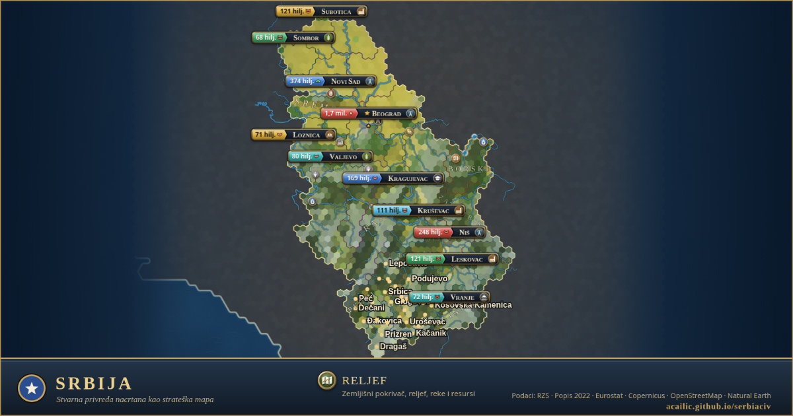

# serbiaciv

**serbiaciv** is an interactive map of Serbia drawn like a 4X strategy game. It combines public geographic and statistical data with a hexagonal map, city views, resources and thematic lenses. It is a data visualisation, not a simulation or a playable game. The interface supports Serbian Latin and Cyrillic.

[Open the atlas](https://acailic.github.io/serbiaciv/) · [Design](docs/superpowers/specs/2026-11-26-serbiaciv-design.md) · [Data contracts](docs/DATA_CONTRACTS.md) · [Glossary](docs/GLOSSARY.md)



### Watch the trailer

[](docs/trailer.mp4)

[Watch or download the 30-second trailer with sound](docs/trailer.mp4).

The project is a Serbia-focused fork of [usaciv](https://karpathy.ai/usaciv) by Andrej Karpathy. The original project is MIT-licensed; see [LICENSE](LICENSE).

## Explore

- **Map:** 5 km hexes show elevation, land cover, rivers, district boundaries and cities. Switch roads, rail, ports, airports, resources and landmarks on or off from the map menu.
- **Cities:** select a city for population, economic indicators and yields. Open its City View for census-based citizen groups, economic districts and surrounding hexes.
- **Lenses:** colour the map by population density, demographic change, wages, education, employment, land cover, elevation and other indicators. Each legend describes the measure and its caveats.
- **Advisors and Explorer:** compare places and examine the economy, people, energy, transport, culture and other subjects.
- **Search and share:** search cities, districts and named Kosovo and Metohija towns in either script. The address preserves the map view and script; the share menu can also export an image.
- **Almanac:** inspect source descriptions and the meaning of the displayed indicators. Press `?` for controls or `/` to search.

## Run locally

Install [uv](https://docs.astral.sh/uv/) and use Python 3.11 or newer. The generated `web/data/` files are included; running the atlas does not require downloading the original datasets.

```bash
uv sync --frozen
uv run python -m pipeline serve
```

Open <http://127.0.0.1:8765>. The site uses ES modules and must be served over HTTP, rather than opened directly as a file. To use another port, add `--port 9000`. No Node installation or web build step is needed to run the site.

## Data and limitations

The map uses sources including the Statistical Office of the Republic of Serbia (RZS), the 2022 census, Eurostat, Copernicus DEM, ESA WorldCover, OpenStreetMap, geoBoundaries and Natural Earth. The in-app Almanac and `web/data/sources.json` list the sources and their vintages. Some hand-curated sites cite publisher pages rather than a downloaded dataset. Each dataset retains its own licence and attribution requirements; the code's MIT licence does not change those terms.

Kosovo and Metohija is included in the map frame. RZS does not provide the corresponding statistical series for that territory, so statistical measures there are missing rather than set to zero; physical layers and named towns are shown where their sources provide them. The map combines a five-district RZS classification with municipal boundaries from geoBoundaries; its approximations are documented in the [design](docs/superpowers/specs/2026-11-26-serbiaciv-design.md).

The grid is schematic. Small municipalities can be smaller than one hex and consequently absent from municipality-based map lenses. The data checker reports these cases and known gaps, including the incomplete mapped division of Novi Sad. A city's per-hex population is an estimate based on municipality density and hex area, not a count of residents at that precise location. Yields are labels for underlying economic and employment indicators, not game statistics; consult the Almanac for definitions and units.

## Rebuild and validate data

The pipeline downloads source files into `data/raw/`, processes them into `data/interim/`, then builds JSON in `web/data/`. Rebuilding all data can involve large downloads and depends on source availability. Raw files and interim data are not included in the repository.

```bash
uv run python -m pipeline list                 # list sources and builders
uv run python -m pipeline all                  # fetch, process, build and check
uv run python -m pipeline all --offline        # use a complete existing download cache
uv run python -m pipeline fetch census        # fetch selected sources
uv run python -m pipeline process census      # process selected sources
uv run python -m pipeline build cities --deps # build a target and its dependencies
uv run python -m pipeline build --force       # force all builders to run
uv run python -m pipeline check               # validate data and report warnings
```

`check` exits nonzero for failures; warnings describe issues that need review but do not fail the command. Data definitions and extension interfaces are in [docs/DATA_CONTRACTS.md](docs/DATA_CONTRACTS.md).

## Test and package

```bash
uv run python -m unittest discover -s tests
node --test $(rg --files web -g '*.test.js')
uv run python -m pipeline package
```

The JavaScript tests require Node.js; the command above also uses `rg`. Packaging produces `serbiaciv.zip`, containing the static site and its downloadable `serbiaciv-source.zip`. The GitHub Pages workflow stages the app, validates data and runs a Chromium smoke test before deployment. That browser test requires Playwright and Chromium; see [tests/browser/smoke.mjs](tests/browser/smoke.mjs).

For a different deployment address, update the canonical and social-image URLs in `web/index.html` and the address printed on shared images in `web/js/app/share.js`.

## Project layout

- `pipeline/sources/` fetches and processes source datasets; `pipeline/build/` builds map and UI data.
- `pipeline/core/` contains shared geography, storage and download utilities; `pipeline/data/` holds reviewed reference tables.
- `web/` contains the static site, JavaScript, styles and generated JSON.
- `tests/` contains pipeline tests and browser smoke checks; `scripts/` contains staging and maintenance utilities.

Contributions are welcome. When changing a dataset, preserve its attribution, document its shape and limitations, and run the relevant tests and `pipeline check`. Code is licensed under [MIT](LICENSE); source data is subject to its respective publisher's terms.
